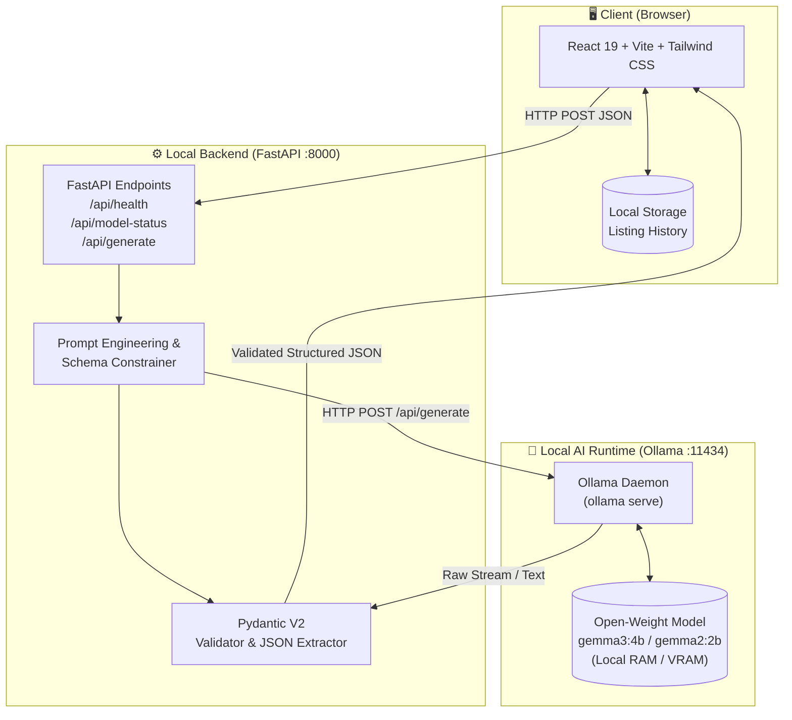

# 🚀 SellerBoost AI — Local-First AI Listing Studio for Small Sellers

> **Hacktoberfest 2026 DEV Community Week 2 Open-Source AI Challenge**  
> **Theme:** *Side Hustle*  
> **Built for:** Indian Small Businesses, Artisans, Handloom Weavers & D2C Hustlers  
> **Powered by:** Open-Weight Gemma (Google DeepMind) via Local Ollama Runtime

---

## 📖 1. Project Overview

**SellerBoost AI** is a local-first, privacy-respecting e-commerce listing studio created for Indian micro-enterprises, Instagram thrift stores, artisan cooperatives, and side-hustlers. 

Selling online in India requires tailoring content across multiple distinct surfaces:
1. **Instagram:** Short visual hooks, emotional storytelling, emojis, and relevant hashtags.
2. **WhatsApp:** Concise, personal, easily shareable catalog blurbs with clear pricing and order instructions.
3. **Marketplaces (Amazon, Flipkart, Meesho, ONDC):** High-ranking SEO titles, bullet points, structured descriptions, and keyword optimization.

Many small sellers cannot afford expensive recurring SaaS copywriter subscriptions or risk sending proprietary product formulations, artisan craft secrets, and wholesale pricing details to third-party cloud AI vendors. **SellerBoost AI executes all AI inference on the user's own computer using open weights, requiring zero cloud API keys and incurring zero per-generation API costs.**

---

## 🏛️ 2. Architecture & Inference Flow



### How the Local Inference Flow Works:
1. **Input Submission:** The seller inputs product details (or clicks a 1-click Indian artisan sample product) into the React UI.
2. **Validation:** FastAPI validates inputs using Pydantic (character length bounds, safe string types, enums for Language, Platform, and Tone).
3. **Controlled Prompting:** The backend builds a strict system prompt instructing the model to output **valid JSON only** matching the `GeneratedListing` schema.
4. **Ollama Execution:** An asynchronous HTTP client (`httpx`) sends the prompt to `http://localhost:11434/api/generate`.
5. **Robust Parsing & Extraction:** The backend extracts the JSON payload even if wrapped in markdown code blocks or conversational wrappers.
6. **Strict Verification:** Response fields are verified (title, description, sales pitch, SEO keywords, social caption, hashtags).
7. **Local Persistence:** The React frontend saves successful results into browser `localStorage`. No remote database is contacted.

---

## 🔒 3. Open-Weight AI & Privacy Analysis

### What Information Stays Local?
- **100% of product input data stays on your machine.** When using the local Ollama runtime, product names, features, proprietary formulations, wholesale pricing, and target audience data never cross the internet.
- **Zero External Telemetry:** SellerBoost AI has no tracking pixels, analytics scripts, or remote logging.

### Privacy vs. Closed Cloud APIs
| Consideration | Closed Cloud APIs (OpenAI, Anthropic) | Local Open Weights (Gemma via Ollama) |
|---|---|---|
| **Data Privacy** | Prompts transmitted across internet; subject to vendor data retention and terms | Data never leaves `localhost` |
| **API Costs** | Recurring per-token charges (USD); requires credit card | **Zero per-request API fees** |
| **Vendor Lock-in** | Subject to API deprecation, rate limits, account bans | Full user ownership and sovereign control |
| **Offline Inference** | Impossible; requires constant internet | **Runs completely offline** once model weights are pulled |

### Hardware & Performance Trade-Offs (Realistic Disclosure)
- **Initial Setup:** Requires downloading model weights over the internet once (e.g., ~2.5 GB for `gemma3:4b` or ~1.6 GB for `gemma2:2b`).
- **Compute Requirements:**
  - **Recommended:** Apple Silicon (M1/M2/M3/M4) or NVIDIA GPU with >= 6GB VRAM for near-instant (2-5s) responses.
  - **CPU Only:** Modern multi-core Intel/AMD CPUs will run `gemma3:4b` in ~8-20 seconds. For older CPUs, switch to `gemma2:2b`.
- **Operating Cost Honesty:** While there are no API subscription costs, running inference utilizes local electricity and hardware compute cycles.

### Verified Model & License Details
- **Default Model:** `gemma3:4b` (configurable via `OLLAMA_MODEL` to `gemma2:2b`, `gemma:2b`, etc.)
- **Developer:** Google DeepMind
- **License:** Governed by the **Gemma Terms of Use**. Gemma models are open-weight models permitting commercial and research applications under responsible use guidelines.
- **Zero Fallback Deception:** SellerBoost AI **never** mocks or fakes AI results when Ollama is offline. If the model is not found, clear diagnostics and terminal setup steps are displayed.

---

## 🛠️ 4. Technology Stack

### Frontend
- **Framework:** React 19 with Vite 8
- **Styling:** Vanilla CSS design tokens with Tailwind CSS v4 `@theme`
- **Icons:** Lucide React
- **Notifications:** React Hot Toast
- **Storage:** Browser `localStorage` (Zero credentials stored)

### Backend
- **Framework:** Python 3.10+ with FastAPI 0.115
- **Data Validation:** Pydantic V2 & Pydantic-Settings
- **HTTP Client:** HTTPX (asynchronous communication with Ollama)
- **CORS:** Restricted strictly to the configured frontend origin (`http://localhost:5173`)
- **Testing:** Pytest & pytest-asyncio

---

## ⚡ 5. Getting Started (Step-by-Step)

### Prerequisites
1. **Node.js** (v18.0 or newer)
2. **Python** (v3.10 or newer)
3. **Ollama** installed from [ollama.com](https://ollama.com)

---

### Step 1: Start Ollama & Pull the Model

Open your terminal:
```bash
# 1. Start Ollama daemon (if not already running)
ollama serve

# 2. In another terminal, pull the Gemma open-weight model:
ollama pull gemma3:4b

# (Optional: for lighter laptops with <= 8GB RAM, pull the 2B model instead):
# ollama pull gemma2:2b
```

---

### Step 2: Set Up & Run the Backend

```bash
# Navigate to the backend directory
cd backend

# Create and activate a Python virtual environment
python -m venv venv

# Windows PowerShell:
.\venv\Scripts\Activate.ps1
# (Or on macOS/Linux: source venv/bin/activate)

# Install dependencies
pip install -r requirements.txt

# (Optional) Customize environment variables
cp .env.example .env

# Start the FastAPI server
uvicorn app.main:app --reload --port 8000
```
Backend will be live at `http://localhost:8000`. You can inspect interactive Swagger docs at `http://localhost:8000/docs`.

---

### Step 3: Set Up & Run the Frontend

Open a new terminal:
```bash
# Navigate to the frontend directory
cd frontend

# Install dependencies
npm install

# Start the Vite development server
npm run dev
```
Open your browser and visit **`http://localhost:5173`**.

---

## 🧪 6. Testing

### Automated Unit & Validation Tests (No Ollama Required)
The test suite validates schema enforcement, minimum length constraints, enums, JSON extraction from noisy model text, and endpoint behaviors:

```bash
cd backend
.\venv\Scripts\pytest.exe tests/test_validation.py -v
```
**Results:** All 25 automated unit tests pass in ~7 seconds without contacting Ollama.

### Real-Model Integration Tests (Requires Running Ollama)
To run end-to-end tests against the live local open-weight model:

```bash
cd backend
# Set environment flag to enable integration suite
$env:SELLERBOOST_INTEGRATION="1"
.\venv\Scripts\pytest.exe tests/test_integration.py -v
```

### Frontend Build Verification
To ensure the production React bundle compiles cleanly:
```bash
cd frontend
npm run build
```

---

## 📡 7. API Reference

### `GET /api/health`
Checks backend service availability.
- **Response:** `{"status": "healthy", "service": "sellerboost-ai"}`

### `GET /api/model-status`
Checks connectivity to Ollama and verifies if the configured model is pulled.
- **Response:**
  ```json
  {
    "ollama_reachable": true,
    "model_available": true,
    "model_name": "gemma3:4b",
    "message": "Ready — using model 'gemma3:4b'."
  }
  ```

### `POST /api/generate`
Generates a structured listing.
- **Request Body:**
  ```json
  {
    "product_name": "Handmade Jute Tote Bag",
    "category": "Eco Fashion & Accessories",
    "features": "100% natural braided jute, reinforced cotton straps, inner zipped pocket.",
    "target_audience": "Urban college students and eco-conscious shoppers.",
    "price": "₹699",
    "language": "english",
    "platform": "instagram",
    "tone": "friendly"
  }
  ```
- **Response:**
  ```json
  {
    "success": true,
    "listing": {
      "seo_title": "Eco-Friendly Artisan Jute Tote Bag with Cotton Handles",
      "description": "Carry your essentials sustainably with this durable hand-braided jute tote bag...",
      "sales_pitch": "Upgrade your daily carry with 100% natural, artisan-crafted jute elegance.",
      "seo_keywords": ["jute tote bag", "eco friendly handbag", "handcrafted tote", "sustainable fashion"],
      "social_caption": "Say goodbye to plastic in style! 🌿 Handwoven by rural artisans...",
      "hashtags": ["#EcoFashion", "#JuteBag", "#SustainableLiving", "#VocalForLocal"]
    },
    "model_used": "gemma3:4b",
    "error": null
  }
  ```

---

## 🇮🇳 8. Authentic Sample Products Included

Try these 1-click presets in the studio to test real-world Indian small business use cases:
1. **Handwoven Katan Banarasi Silk Saree** *(Varanasi Handloom, Premium tone, Instagram-optimized)*
2. **Handmade Terracotta Clay Water Bottle** *(Zero-waste kitchen, Friendly tone, Marketplace SEO)*
3. **Dadi Ke Hath Ka Aam Ka Achar** *(Homemade sun-dried pickle, Hindi language, WhatsApp catalog)*
4. **Artisan Kolhapuri Leather Slip-On Chappals** *(Athani artisans, Professional tone, Generic Marketplace)*

---

## 🤝 9. Hacktoberfest Contributing & Guidelines

Contributions are welcome! Please follow these standards:
1. **No Cloud Fallbacks:** Do not introduce closed cloud API keys (OpenAI/Anthropic) as hidden dependencies. The core philosophy is sovereign local open weights.
2. **No Fake AI Output:** Never return hardcoded mock responses on generation failure. Return clear error diagnostics instead.
3. **Strict Validation:** Ensure all new input fields include Pydantic validations with bounded length constraints.
4. **CORS Integrity:** Maintain strict CORS boundaries for the local origin.

---

## 📜 10. License

This repository is licensed under the **MIT License**. The underlying Gemma open-weight models are governed by the **Gemma Terms of Use**.
